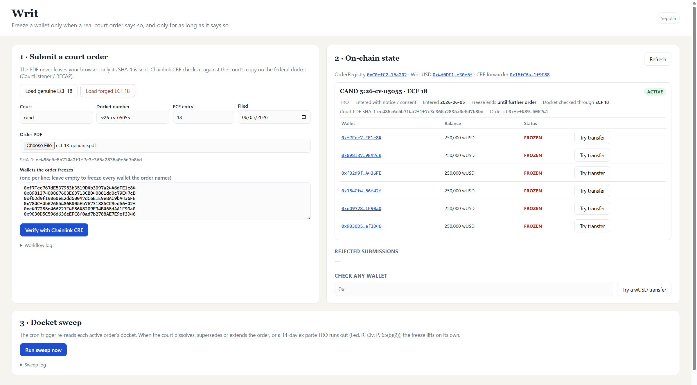
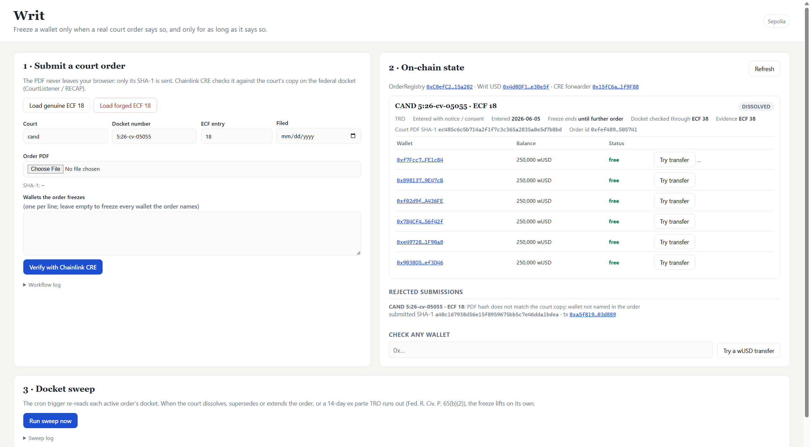
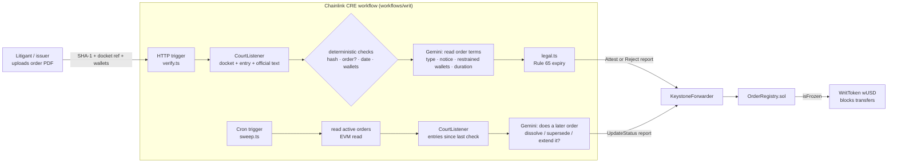

# Writ

**A wallet should be frozen only when a real court order says so, and only for as long as the order says so.**

Writ is a Chainlink CRE workflow that sits between court orders and a stablecoin's freeze list. When someone submits an order, Writ:

1. verifies it against the public federal docket on CourtListener;
2. extracts the named wallets and the order's duration with Gemini;
3. writes a DON-signed attestation on-chain, which makes the token refuse transfers from exactly those wallets.

A cron trigger then keeps watching the docket. When the court dissolves or supersedes the order, the freeze lifts automatically. It also lifts when a 14-day ex parte TRO runs out under Fed. R. Civ. P. 65(b)(2). No one has to remember to unfreeze anything.

Built for the **Chainlink "Best workflow with CRE"** track at BLI Legal Tech Hackathon 2.

| Before: the order is verified and its wallets are frozen | After: the docket sweep found the order that dissolved it |
| --- | --- |
|  |  |

## The problem

Stablecoin issuers freeze wallets because courts tell them to. This is real and current. In *Newton AC/DC Fund, L.P. v. Ermilov*, No. 5:26-cv-05055 (N.D. Cal.), the plaintiffs named **Circle Internet Financial as a relief defendant**. They obtained a TRO that enjoins transfers from six specific wallets. Today an issuer handles orders like this by hand, and that has three failure modes:

- **Forged orders.** A PDF with one wallet swapped is enough to freeze a victim or unfreeze a target. Compliance teams rarely check the court's own copy.
- **Over-freezing.** Addresses that appear in an order without being restrained by it get frozen anyway.
- **Zombie freezes.** A TRO granted without notice expires 14 days after entry unless extended (Rule 65(b)(2)). A TRO pending a preliminary-injunction motion ends when that motion is denied. Issuer freezes routinely outlive the orders that justified them.

## How it works



**Verify (HTTP trigger).** The UI hashes the PDF in the browser, so the file itself never leaves the user's machine. The workflow then:

1. Looks up the docket and the entry on CourtListener (Free Law Project's RECAP mirror of PACER).
2. Runs deterministic checks:
   - the docket and the entry exist;
   - the clerk's docket text describes a signed order, not a motion or a proposed order;
   - the submitted SHA-1 equals the SHA-1 of the court's PDF;
   - the claimed filing date matches the docket.
3. Hands the **court's own OCR text** (never the submitted file) to Gemini, which returns the order type, whether it was granted without notice, the wallets it restrains, and any stated term.
4. Freezes a wallet only if it **appears verbatim in the official text** and Gemini says the order restrains it. Every claimed wallet must pass that test.
5. Computes the expiry in code (see below), then writes an `Attest` report. If any check failed, it writes a `Reject` report with a reasons bitmask instead.

**Sweep (cron trigger).** For each active order, the workflow:

1. fetches the docket entries filed since the last check;
2. keeps only those whose docket text looks like an order;
3. asks Gemini whether any of them dissolves, supersedes or extends the order;
4. writes the new status, citing the evidence entry and its PDF hash.

If no new order affects it and its fixed term has passed, the order is marked `Expired`. Otherwise the sweep writes a checkpoint so those entries are never reviewed twice.

**Enforcement.** `OrderRegistry.isFrozen(wallet)` is true only while an `Active` order names the wallet and `block.timestamp < expiresAt` (or `expiresAt == 0`, "until further order"). Because expiry is evaluated at read time, a 14-day ex parte TRO stops freezing on day 15 even if no transaction is ever sent. `WritToken` checks `isFrozen` on every transfer.

## Legal framing

| Situation | What Writ does | Source |
| --- | --- | --- |
| TRO granted **without notice** (ex parte) | Expires 14 days after entry, or sooner if the court set a shorter term, even if the text says "until further order" | Fed. R. Civ. P. 65(b)(2) |
| Ex parte TRO **extended** for good cause | New expiry = stated date, or one more 14-day period | Rule 65(b)(2) |
| TRO entered **with notice or by consent** | No automatic expiry; it lasts until further order | Rule 65(b)(2) applies only to TROs issued without notice |
| TRO pending a PI motion, then the **PI is denied** | Status → `Dissolved`, with the denial order as evidence | The TRO only preserved the status quo pending that motion |
| **Preliminary injunction / amended order** replaces the TRO | Status → `Superseded` | |
| Sealed order, or an order not on RECAP | Cannot be verified from the public docket, so the issuer uses `overrideStatus` (owner-only, emits `HumanOverride` with a note) | |

The ex parte call is made by Gemini and then **overridden by the clerk's docket text**. If the entry says "stipulated" or "consent", the order is treated as entered with notice, whatever the model says. This matters in our demo: ECF 18 says the plaintiffs *applied* ex parte, but the order itself was entered by stipulation of both parties. Treating it as a 14-day ex parte TRO would have unfrozen the wallets early.

**What the LLM is trusted with:** reading. **What it is not trusted with:** which wallets are frozen (they must appear verbatim in the official text), whether the document is genuine (SHA-1), the dates (taken from the docket), and the expiry arithmetic (`legal.ts`).

*This is a demo on Sepolia with test tokens. It is not legal advice, and a production deployment would need counsel's review of each jurisdiction's rules.*

## Demo: a real case, end to end on Sepolia

Case: *Newton AC/DC Fund, L.P. v. Ermilov*, No. 5:26-cv-05055-PCP (N.D. Cal.), [CourtListener docket 73408471](https://www.courtlistener.com/docket/73408471/newton-acdc-fund-lp-v-ermilov/). See [`fixtures/README.md`](fixtures/README.md) for provenance.

| Step | Input | Result | Tx (Sepolia) |
| --- | --- | --- | --- |
| Verify the genuine order | ECF 18, *Stipulated Consent TRO*, the court's PDF (SHA-1 `ec485c6c…`) | **VERIFIED**: 6 wallets frozen "until further order" (consent TRO, so no 14-day cap) | [`0xace96838…`](https://sepolia.etherscan.io/tx/0xace968382904840a7f8b035638a10a3b3a3a2ab84a23d548524239fd2e3304a0) |
| Verify a forged copy | ECF 18 with wallet 5 swapped for an attacker address (SHA-1 `a40c1679…`) | **REJECTED**, reasons `24` = PDF hash mismatch + wallet not in the order | [`0xa5f819c7…`](https://sepolia.etherscan.io/tx/0xa5f819c77b9c3e5d6f2095b44493f68b2a886004d66dcad3ae4f05ed8203d889) |
| Cron docket sweep | 20 new entries after ECF 18; 3 look like orders (two pro hac vice orders, and ECF 38) | **DISSOLVED** on the evidence of ECF 38, *Order denying motion for preliminary injunction* | [`0xfcdf44f5…`](https://sepolia.etherscan.io/tx/0xfcdf44f5df1381f3ca4c9d7ad7ab98a5aeb000c850a66d04221c695766b7e4a8) |

While the order was active, a wUSD transfer from a named wallet reverted with `WalletFrozen(0xe4972…)`. After the sweep, the same call succeeds. Full CLI output is in [`logs/`](logs/).

Deployed contracts (Sepolia, `deployments/sepolia.json`):

- `OrderRegistry`: [`0xC0efC2d0B41Bbcb9d26C7F4F32678a247E15a202`](https://sepolia.etherscan.io/address/0xC0efC2d0B41Bbcb9d26C7F4F32678a247E15a202)
- `WritToken` (Writ USD, wUSD): [`0x4d0DF1DF351d3035A9AEa82cc34Fc4d4C5e30e5f`](https://sepolia.etherscan.io/address/0x4d0DF1DF351d3035A9AEa82cc34Fc4d4C5e30e5f)
- CRE forwarder (simulation `MockKeystoneForwarder`): [`0x15fC6ae953E024d975e77382eEeC56A9101f9F88`](https://sepolia.etherscan.io/address/0x15fC6ae953E024d975e77382eEeC56A9101f9F88)

## CRE simulation trace: external request, chain read, signed result

From [`logs/trace-verify-forged.log`](logs/trace-verify-forged.log), a `--broadcast` run of the HTTP trigger:

```text
[identity] trigger signer: none (local simulation; set httpAuthorizedKey when deployed)
[chain]    OrderRegistry.getOrder(0xfef489dd…) at finalized block: status=Active          <- blockchain read (EVMClient.callContract)
[check]    PASS docket exists: Newton AC/DC Fund, L.P. v. Ermilov (CourtListener #73408471)  <- external request (CourtListener)
[check]    PASS entry exists: ECF 18 filed 2026-06-05                                       <- external request (CourtListener)
[check]    FAIL document hash: court PDF sha1=0xec485c6c… submitted=0xa40c1679…
[gemini]   type=TRO withoutNotice=false untilFurtherOrder=true expiry="" days=0 wallets=6   <- external request (Gemini)
[check]    FAIL claimed wallets are in the order: not in order: 0x4c1f0b2d…
[report]   DON-signed report (ecdsa, keccak256) over 544 bytes -> writeReport to 0xC0efC2d0… <- signed result
[verify]   REJECTED submission 0x65bdf2f4…: HashMismatch, WalletNotInOrder tx=0xa5ba48c8…
```

Signed-result tx: [`0xa5ba48c8…`](https://sepolia.etherscan.io/tx/0xa5ba48c83afd2742240bfd3ca071eaf840f6ec3a5516ac15da3f09376abb2b70). The cron trigger produces the same three parts in [`logs/sweep-dissolve.log`](logs/sweep-dissolve.log): registry reads, then CourtListener and Gemini, then a signed `UpdateStatus` report.

### How identity signals reach the workflow

| Identity | How it enters | Where it is checked |
| --- | --- | --- |
| **Who may submit** (the issuer's compliance desk) | The HTTP trigger request is signed by an EVM key. `httpAuthorizedKey` in the config becomes the trigger's `authorizedKeys`, so the DON drops unsigned or foreign requests. The signer arrives as `payload.key` and is logged. | CRE gateway / trigger, before any code runs |
| **Which court document** | The payload carries `court`, `docketNumber`, `entryNumber` and the PDF's SHA-1. The PDF itself never leaves the browser. | `verify.ts` checks each against CourtListener; order id = `keccak256(abi.encode(court, docketNumber, entry))` |
| **Which wallets** | A claimed list in the payload | Each wallet must appear verbatim in the court's official text **and** be named by Gemini as restrained |
| **API credentials** | `COURTLISTENER_TOKEN` and `GEMINI_API_KEY` are CRE secrets (`secrets.yaml`; `.env` in simulation, the Vault DON when deployed), fetched with `runtime.getSecret` inside handlers | Never in config, payloads, logs or reports |
| **Which workflow may write on-chain** | Reports are signed by the DON and delivered through the Keystone forwarder, with workflow id and owner in the report metadata | `CREReceiver.onReport`: `msg.sender == forwarder`, plus `pinWorkflow(owner, workflowId)` in production |

## Responsible AI and ethics

- **The model reads; it does not decide.** Gemini extracts terms from the court's own text. Code decides who is frozen and until when: wallets must appear verbatim in the official text, the PDF must hash-match the court's copy, dates come from the docket, and the Rule 65 arithmetic is in tested code. A hallucinated wallet cannot be frozen, because it does not appear in the text.
- **Fail-safe defaults.** If anything is missing (no docket, no RECAP copy, unreadable OCR, no wallets), the submission is rejected with machine-readable reasons, never partially applied. The model's ex parte call is overridden by the clerk's docket text when the order is stipulated or consented.
- **Freezes end on time.** Expiry is enforced at read time, so a lapsed ex parte TRO stops freezing even if no one sends a transaction, and the sweep lifts freezes when the court lifts the order. Over-long freezes are an ethical harm too: they deprive people of property without a court's authority.
- **Prompt-injection resistant.** Order text is passed as delimited untrusted data with a fixed JSON response schema at temperature 0, and outputs are normalized and cross-checked before use.
- **Privacy.** Only a hash of the uploaded PDF is sent. All evidence used is public court records, and on-chain records contain the docket reference, hashes and wallets only, no personal names.
- **Human in the loop.** The issuer's compliance owner can correct any status (`overrideStatus`) for sealed orders, appeals or errors. Every override emits a `HumanOverride` event with a note, and every automated change cites the docket entry and PDF hash that justified it, so the full history is auditable on-chain.
- **Scope.** U.S. federal dockets on CourtListener only; not legal advice.

## Files that use Chainlink

| File | Role |
| --- | --- |
| [`project.yaml`](project.yaml) | CRE project settings (Sepolia RPC per target) |
| [`secrets.yaml`](secrets.yaml) | CRE secrets mapping: `COURTLISTENER_TOKEN`, `GEMINI_API_KEY` |
| [`workflows/writ/workflow.yaml`](workflows/writ/workflow.yaml) | Workflow name, entry point, config and secrets paths |
| [`workflows/writ/config.staging.json`](workflows/writ/config.staging.json) | Registry address, chain selector, gas limit, Gemini models, cron schedule |
| [`workflows/writ/main.ts`](workflows/writ/main.ts) | `Runner` + two handlers: `HTTPCapability` trigger and `CronCapability` trigger |
| [`workflows/writ/verify.ts`](workflows/writ/verify.ts) | HTTP handler: secrets, CourtListener + Gemini via `HTTPClient`, `runtime.now()`, report |
| [`workflows/writ/sweep.ts`](workflows/writ/sweep.ts) | Cron handler: EVM reads, docket sweep, status reports |
| [`workflows/writ/courtlistener.ts`](workflows/writ/courtlistener.ts) | `HTTPClient.sendRequest` with `consensusIdenticalAggregation` and response caching |
| [`workflows/writ/gemini.ts`](workflows/writ/gemini.ts) | Gemini calls in node mode with identical-consensus outputs and model fallback |
| [`workflows/writ/registry.ts`](workflows/writ/registry.ts) | `EVMClient.callContract` (finalized-block reads), `runtime.report` + `EVMClient.writeReport`, tx and receiver status checks |
| [`contracts/src/interfaces/CREReceiver.sol`](contracts/src/interfaces/CREReceiver.sol) | `IReceiver.onReport`: forwarder-only, optional workflow id/owner pinning |
| [`contracts/src/interfaces/IReceiver.sol`](contracts/src/interfaces/IReceiver.sol) | Chainlink receiver interface |
| [`contracts/src/OrderRegistry.sol`](contracts/src/OrderRegistry.sol) | Decodes `Attest` / `Reject` / `UpdateStatus` reports; freeze and expiry logic |
| [`web/server.ts`](web/server.ts) | Demo bridge that fires the workflow's triggers with `cre workflow simulate --broadcast` |

Other files: `legal.ts` (deterministic Rule 65 logic, no Chainlink calls), `contracts/src/WritToken.sol` (an ERC-20 that consults the registry), the tests, and `scripts/`.

## Why CRE

- **No single party is trusted with the docket.** Every DON node fetches CourtListener and Gemini, and the result goes on-chain only if the nodes reach identical consensus. Cached responses keep this within CourtListener's rate limit and make LLM output reproducible across nodes.
- **Signed delivery.** Reports are DON-signed and delivered through the `KeystoneForwarder`. `OrderRegistry` accepts nothing else, and in production it can be pinned to this workflow's id and owner (`pinWorkflow`).
- **Time is a first-class input.** The cron trigger lifts freezes when the law says they end, and `runtime.now()` gives every node the same clock for the expiry checks.
- **Secrets stay out of the chain.** The CourtListener token and Gemini key live in CRE secrets (`.env` for simulation).

## Run it

Prerequisites: [CRE CLI](https://docs.chain.link/cre) (logged in with `cre login`), [Bun](https://bun.sh) ≥ 1.2, [Foundry](https://getfoundry.sh), a CourtListener API token, a Gemini API key, and a Sepolia key with test ETH.

```powershell
git clone --recurse-submodules https://github.com/emarc99/writ-dockett.git
cd writ-dockett
Copy-Item .env.example .env     # fill in CRE_ETH_PRIVATE_KEY, COURTLISTENER_TOKEN_VAR, GEMINI_API_KEY_VAR

# contracts: 15 Foundry tests, optional redeploy (prints addresses and writes deployments/sepolia.json)
cd contracts; forge test; cd ..
./scripts/deploy.ps1            # then put the new registry address in workflows/writ/config.staging.json

# workflow: 14 unit tests, then simulate both triggers against Sepolia
cd workflows/writ; bun install; bun test; cd ../..
cre workflow simulate workflows/writ --target staging-settings --non-interactive --trigger-index 0 --http-payload payloads/genuine.json --broadcast
cre workflow simulate workflows/writ --target staging-settings --non-interactive --trigger-index 0 --http-payload payloads/forged.json --broadcast
cre workflow simulate workflows/writ --target staging-settings --non-interactive --trigger-index 1 --broadcast
```

The sweep reads the registry at the last **finalized** block, so run it about 15 minutes after a verification lands.

Demo UI (local only; it runs the same `cre` commands and streams their output):

```powershell
cd web; bun install; bun server.ts    # http://localhost:8787
```

Use **Load genuine ECF 18** or **Load forged ECF 18**, then **Verify with Chainlink CRE**. Watch the checklist fill in, try a transfer from a frozen wallet, and run the sweep.

### Going to production

- Deploy `OrderRegistry` with the Sepolia `KeystoneForwarder` (`0xF8344CFd5c43616a4366C34E3EEE75af79a74482`), or call `setForwarder`.
- After `cre workflow deploy`, call `pinWorkflow(owner, workflowId)` so only this workflow can write.
- Set `httpAuthorizedKey` in the workflow config so only the issuer's signing key can fire the HTTP trigger.

## Limits and honest caveats

- Only orders whose PDF is on RECAP can be verified. Sealed or unpurchased orders need the human override.
- CourtListener `plain_text` is OCR. A wallet garbled by OCR will not match and will not be frozen, which fails safe.
- The sweep reads one page (20 entries) per order per run and checkpoints, so a busy docket takes a few runs to catch up.
- Rule 65(b) timing is measured from the docket entry date at 00:00 UTC; the order's exact time of entry is not on the docket API.
- Not legal advice.

## Repository layout

```
contracts/          Foundry: OrderRegistry, WritToken, CRE receiver, tests
workflows/writ/     CRE workflow (TypeScript): verify + sweep handlers, legal rules, tests
payloads/           HTTP trigger payloads for the demo (genuine, forged)
fixtures/           Real court PDFs and OCR text from CourtListener, plus the forged copy
web/                Local demo UI (Bun server + viem)
logs/               CLI output of the Sepolia broadcasts above
scripts/            deploy.ps1, make_forged_order.py
deployments/        Deployed addresses
```

## License

MIT. Court documents in `fixtures/` are public records obtained from CourtListener / RECAP.
